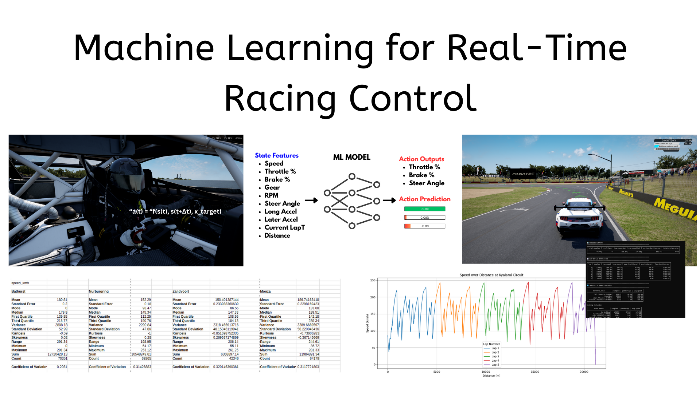
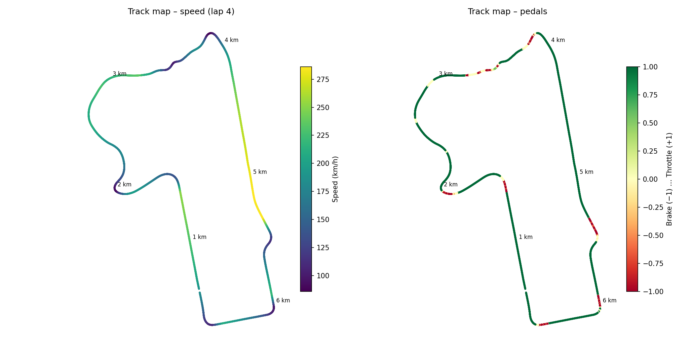
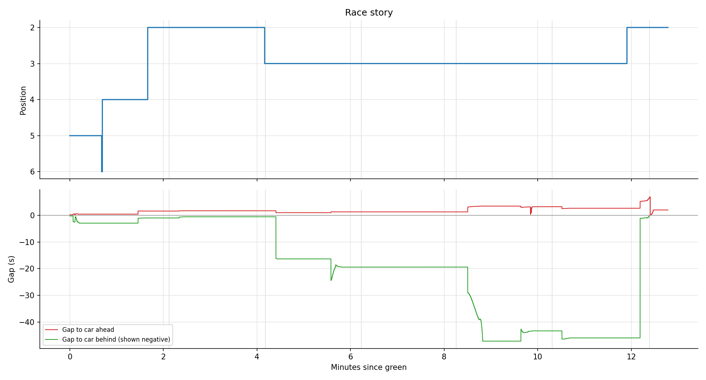
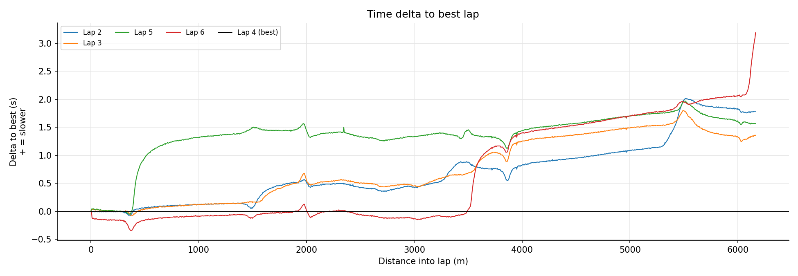
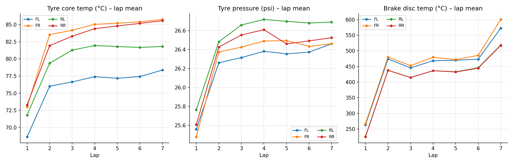

# AC Telemetry Analytics

A Python-based telemetry capture and analysis tool for Assetto Corsa Competizione, capturing real-time driving data at 100Hz and transforming it into insights, built to practice data analytics skills while racing.



**Status (Nov 2026):** the same telemetry now drives the car. Laps recorded with `reader.py` rebuild Mount Panorama as a reference line, and `pilot.py` drove a full lap of it in ACC with no human input (classical control, 75% pace, a median 0.32 m from the line). Networks evolved in [ML Track Trainer](https://github.com/Yaandle/ML-Track-Trainer) can be imported and refined here. See [Driving a lap](#driving-a-lap-second-attempt-nov-2026).

## Current workflow (Oct 2026)

Three steps: record a race, make graphs, explore laps in the dashboard.

```bash
python reader.py                                   # record (start before the race, Ctrl+C after)
python plot_session.py telemetry_logs/<file>.csv  # PNG graphs -> graphs/<file>/
```

Then open `dashboard/index.html` in a browser and load the CSV.

| File | Purpose |
|---|---|
| `acc_memory.py` | ACC shared memory layouts (physics, graphics, static) as ctypes structs, copied from the v1.8.12 PDF. Fields are read by name. |
| `reader.py` | 100 Hz logger. 66 columns: inputs, kinematics, race position, gaps, official lap times, valid-lap flag, flags, world coordinates, tyre temps/pressures, brake temps, slip angles, TC/ABS. File name includes the track. |
| `feature_schema.py` | Column list and metadata for every logged field. |
| `plot_session.py` | Lap times (invalid laps greyed), speed overlay, delta to best, braking points, best-lap inputs with TC/ABS, G-G, per-lap consistency and fuel, tyres, track map, race story. Old CSVs still work; graphs needing new columns are skipped. |
| `dashboard/` | Browser dashboard (no install), replacing the Streamlit apps and terminal summary. **Map:** zoomable track with each lap's racing line, line spread (exaggerates sideways differences), click a corner to compare laps, linked speed / line-offset / delta charts; scroll down for best-lap track maps by speed and by pedals, speed traces and delta to best for every flying lap. **Race:** lap times, position, gaps ahead/behind, fuel, lap-by-lap table. **Driving:** G-G, braking zones, throttle/brake/steering/gear distributions, best-lap inputs (speed, throttle/brake with TC/ABS, steer, gear) and lap-by-lap consistency (avg speed, full throttle, braking, coasting, overlap, fuel). **Car:** tyre temps and pressures, brake temps, TC/ABS, wheel slip, suspension. **Data:** session summary, data quality, stats for every channel. Exports the circuit for ML Track Trainer. |

### Racing lines

ACC doesn't publish the track centreline or edges, but it does give each car's world position and its position along the game's track spline (`normalizedCarPosition`). Laps are aligned by that spline position, the **reference line** is the median path of your flying laps, and each lap's line is shown as its sideways offset from it (metres, + = left). The shaded band on the dashboard map is the width your laps actually used.

### Example: 12-minute online race, Mount Panorama (30 Oct 2026)

Started P5 on a rolling start, finished P2. Best lap 2:01.612 (lap 4).

| | |
|---|---|
|  |  |
|  |  |

### Driving a lap: second attempt (Nov 2026)

The first attempt (`legacy/driver.py`, Jan 2026) gave every model local vehicle state only: speed, slip, suspension. No model knew where the road went next, so none could finish a lap. The logger now records world position, heading and spline position, which is enough to rebuild the track and let a controller see ahead.

```bash
python track_line.py telemetry_logs/*mount_panorama.csv --out tracks/mount_panorama.json
python pilot.py --sim                                   # test lap on a car fitted to your telemetry
python pilot.py --pace 0.8                              # live in ACC
python pilot.py --pace 0.8 --laps 5                     # five timed laps, start/finish to start/finish (0 = until Ctrl+C)
python track_line.py telemetry_logs/*mount_panorama.csv --edges tracks/mount_panorama.json   # road edges for the GA sim
python pilot_evolve.py --gens 300                       # ML Track Trainer neuroevolution on the real line
python pilot.py --sim --policy mltt --weights tracks/mount_panorama.evolved.json
```

**Bringing a network over from ML Track Trainer:** train in the browser, click **Export best model**, then refine it on the real line and car (`--seed-from` starts the population from it) and drive it:

```bash
python pilot_evolve.py --gens 60 --seed-from model-<file>.json --out tracks/mount_panorama.seeded.json
python pilot.py --policy mltt --weights tracks/mount_panorama.seeded.json --pace 0.75
```

The network's 9 inputs describe the road relative to the car (speed, offset, heading error, five look-ahead angles, steer), not a particular circuit, so a genome trained on one track gives a head start on another. Seeded from a browser-trained genome, the first sim lap came at generation 2 instead of 16.

| File | Purpose |
|---|---|
| `track_line.py` | Reference line (median of your flying laps, 2 m grid) with your speed / pedal / gear profile and a car envelope (accel, braking, cornering grip, steer per curvature, by speed). Live: world (x, z) to distance, lateral offset, heading error and look-ahead angles, the same inputs ML Track Trainer uses. |
| `pilot.py` | 100 Hz driver. `classical`: pure-pursuit steering plus a speed target (your trace × `--pace`, capped by a braking envelope). `mltt`: a ML Track Trainer network steers and pedals, with the speed envelope as governor and fallback. `SteerComp` scales the joystick up to undo ACC's speed-dependent gamepad steering, and an inner loop trims what's left. Laps run start/finish to start/finish: the drive from wherever the car starts to the first crossing is an untimed out-lap, then `--laps` timed laps (0 = until Ctrl+C), each with its time, ACC's official time and validity (live), and line error. Logs to `training_logs/pilot_*.csv` (state, commands, measured steer, position, gear, lap number) with a `.json` summary. |
| `pilot_sim.py` | Stand-in for ACC with the same read/write interface: the fitted car on the same line, with steering lag, delayed observations, a steering mismatch factor, ACC-style speed-scaled steering (`--acc-steer`) and understeer past the grip limit. |
| `pilot_evolve.py` | Port of ML Track Trainer's GA (64 drivers, [9, 12, 8, 2] tanh, same reward shape), vectorised in numpy, on the real line and fitted car. Saves weights in the browser's format; `--seed-from` starts from an exported genome. |
| `tracks/` | Reference lines (`mount_panorama.json`, built from the 1 Nov session; `mount_panorama_20261030.json`, the first line), evolved genomes, and `acc_steer_gain.json`, the learned ACC steering gain per speed band. |

**Results so far:** the first line was built from 8 flying laps (30 Oct, 2:01.4–2:04.9). Its distance along the line matches ACC's own spline position with a median error of 0.15 m (95% within 0.33 m). The classical pilot completed a standing-start lap at 75 / 85 / 95 % pace in 2:42 / 2:24 / 2:10, staying within 1.4 m of the line. It still finishes when the car needs 0.6–2× the fitted steer, with double the steering lag, or from a flying start. Fed your real laps in shadow mode with no training, its steer correlates r = 0.71 with yours (0.73 on the 1 Nov line). A linear regression on the same look-ahead inputs explains about half of your steering (R² 0.52–0.56), against 0.51 for January's steering model. The evolved network laps from generation ~16 and reaches 1:48.5 by generation 285. That beats every human lap, so it's exploiting the sim (no elevation, guessed 7.5 m half-width road) and uses the full road width. Try the classical pilot in ACC first.

**First live run (1 Nov):** the classical pilot drove 22% of a lap (470 m to 1878 m), from after Hell Corner through Griffins Bend, before a kerb or contact on the climb to The Cutting spun the car. Its log shows ACC applied only 0.2–0.5× of the commanded steer above 25 m/s (0.7× below 15 m/s), so the car ran wide all lap. That pattern points at the gamepad speed-sensitivity or steer-filter settings below. The line is now rebuilt from the 5 flying laps of the 1 Nov session (2:01.3–2:02.2, line spread 3.8 m vs 8.4 m). On it the sim laps in 2:23.5 / 2:09.5 at 85 / 95 % pace. The old line is kept as `tracks/mount_panorama_20261030.json`.

**First full lap (2 Nov):** `pilot.py` now compensates for ACC's speed-scaled gamepad steering (`SteerComp`, learned per 5 m/s band and saved to `tracks/acc_steer_gain.json` after each live run). Before that, live runs reached 22%, 43%, and 55% (seeded MLTT genome), each ending wide in a corner. The next classical run at `--pace 0.75` drove the full 6.17 km from a standing start in about 163 s (not an ACC-timed lap; the pilot printed 157.5 s because it counted 10 ms frames and the live loop runs ~4% under 100 Hz, now fixed): median 0.32 m from the line, max 3.1 m, no recovery, and never outside the road edges measured from your laps. (ACC leaves `numberOfTyresOut` at 0 in every log, so `tyres_out` can't show track limits.) ACC's steer then matched the requested steer to within 1–6% below 180 km/h, and 10% above it.

**Sim, current line (standing start):**

| Policy | 75% pace | 85% | 95% | Max line error |
|---|---|---|---|---|
| Classical | 2:41.3 | 2:23.5 | 2:09.5 | 1.1–1.6 m |
| Evolved from scratch | 2:40.8 | 2:23.8 | 2:10.5 | 8.3 m, ~9 s recovering |
| Seeded from a browser genome | 2:36.8 | 2:19.6 | 2:08.9 | 5.4–5.7 m |

Live, the seeded network has reached 55% of a lap so far; the full lap is the classical controller. The from-scratch genome's 1:48.5 in the evolution sim beats every human lap because it exploits the sim: it spends 9% of the lap past the guessed 7.5 m road edge and 15% pinned at the modelled grip limit.

**Road edges (2 Nov):** `pilot_evolve.py` no longer uses a flat 7.5 m road. `track_line.py --edges` measures how far your own laps went each side of the line (98th percentile per 10 m) and saves `tracks/<name>.edges.json`. The evolution sim treats that + 0.5 m as the road, with the wall 3 m further out. Past the grip limit the car now scrubs speed instead of clamping for free. `--flat-edges` brings back the old sim. Every `pilot.py` log now has a `.json` summary next to it (mode, policy, weights, pace, result). The running record of methods and results is [docs/ml_record.md](docs/ml_record.md).

**Next:** live MLTT laps with steer compensation on the retrained genome; higher pace; rolling race starts (pace-car speed, green flag, gap to the car ahead).

**ACC setup:** automatic gearbox on (or `--manual-gears`), TC and ABS on. Gamepad: steer gamma 1.0, deadzones 0 (speed sensitivity and steer filter at 0 help, but `SteerComp` handles ACC's speed-scaled steering either way). Start a practice or hotlap session, drive onto the track, then run `pilot.py`. It refuses to start more than 10 m from the line (for example in the pit lane). `pilot.py` drives through [vgamepad](https://github.com/yannbouteiller/vgamepad), which installs the ViGEmBus driver.

### Linked project

[ML Track Trainer](https://github.com/Yaandle/ML-Track-Trainer) is a browser simulator for training small driving networks by neuroevolution. It can import a circuit directly from one of these CSVs (or from the dashboard's **Track → ML Trainer** export), and its **Export best model** file is what `pilot.py --weights` and `pilot_evolve.py --seed-from` read. `dashboard/acc-csv.js` is shared by both projects; keep the copies identical.


## What The System Does (Files)

### 🎮 Data Capture (`reader.py`)
Captures real-time telemetry from Assetto Corsa's shared memory at 100Hz:

**Core Telemetry:**
- Speed, inputs: Throttle, brake, steering (raw + smoothed)
- Lap tracking: Current lap, completed laps, lap fraction, distance
- Vehicle kinematics: Velocity vectors (vx, vy, vz), acceleration (ax, ay, az)
- Derived features: Longitudinal/lateral acceleration, lap progress

**Advanced Telemetry:**
- Wheel dynamics: Slip ratios, slip angles, suspension travel (all 4 wheels)
- Smoothed control inputs: Moving average filter for noise reduction
- Real-time session tracking: Automatic lap detection, statistics

**Output:** Timestamped CSV logs with 66 telemetry channels (see `feature_schema.py`)

### 📊 Analytics (`legacy/telemetry_analysis_terminal.py / legacy/telemetry_analysis_streamlit.py`)
The January analytics tools, now in `legacy/`. Day-to-day analysis uses `plot_session.py` and `dashboard/`; the terminal script is still how the January ML datasets are built.

**Core Capabilities:**
Session summaries: Max/avg speeds, lap breakdowns, G-forces
Input distributions: Throttle, brake, steering usage patterns
Wheel telemetry: Slip, suspension travel analysis
ML dataset preparation: State-action pairs, normalised datasets, temporal sequences

**Differences:**
telemetry_analysis_terminal.py – CLI-first, textual summaries, fast iteration
telemetry_analysis_streamlit.py – Web-based, interactive charts and sliders

**Shared Foundation:**
Both use feature_schema.py for consistent feature definitions
Both consume CSV data produced by reader.py
Differences limited to interface and visualisation


### 🎮 Driver (`legacy/driver.py`)

The January 2026 driver, kept for comparison: it runs the Linear / MLP / GA / DQL models trained by `legacy/ml_trainer.py` on 17 local-state features, with no track context. None completed a lap. The current driver is `pilot.py` (see [Driving a lap](#driving-a-lap-second-attempt-nov-2026)).

Executes trained or evolving policies inside the live driving environment.

This file closes the loop between:
**state → policy → action → consequence**

It is the system's **actuation layer** and a prerequisite for any real-world iteration.

**What it consumes:**
- Live vehicle state from shared memory
- Feature schema for state construction
- Trained policy artifacts (Linear, MLP, GA, DQL)

**What it produces:**
- Real-time control commands (steer, throttle, brake)
- Completed laps (or failures)
- Episode-level performance signals:
  - Distance driven
  - Laps completed
  - Stability (off-track, spins, stalls)
  - Policy collapse or divergence

**Why it matters:**
Offline metrics (R², loss) do not guarantee drivability.
`legacy/driver.py` is where policies either *move the car* or fail visibly.

This file is introduced in **Stage 3 (System Formation)** and becomes the
primary tool for **Stage 5–8 (Reality Iteration)**.


### 🧩 Feature Schema (`feature_schema.py`)
**Single source of truth** for ML feature definitions:

**Purpose:**
- Ensures consistency across all pipeline components
- Prevents feature order mismatches between training and inference
- Validates data integrity with runtime checks
- Eliminates action leakage (actions never included as state inputs)

**What It Provides:**
- `POLICY_FEATURES`: Exact 17-feature state vector definition
- `ACTION_LABELS`: Output labels (gas, brake, steer)
- `build_state_from_row()`: Construct state from CSV data
- `build_state_from_memory()`: Construct state from shared memory
- `validate_state()`: Runtime validation of feature count
- `validate_normalization()`: Check normalization array shapes

**Why It Matters:**
Without a centralized schema, it's easy to introduce bugs where training uses features in one order but inference expects a different order. This file eliminates that entire class of errors by making feature order explicit and validated.

### 🤖 ML Training (`legacy/ml_trainer.py`)
Train baseline models to predict driver inputs from vehicle state:

**Models:**
- Linear Regression (simple baseline)
- MLP (Multi-Layer Perceptron) with various architectures
- Extensible for GA or DQL policies in future experiments

**Evaluation:**
- Per-action metrics: RMSE and R² for gas, brake, steering
- Overlay plots comparing actual vs predicted
- Automated model benchmarking and comparison

**Output:**
- Trained models (Linear, MLP, etc.)
- Performance metrics and plots
- Normalized datasets for inference
- Training reports documenting model performance

**Feature Validation:**
- Checks feature count matches schema
- Validates normalization arrays
- Prevents training with mismatched or corrupted datasets

### 📦 Export Tools (`export_file.py`)
Efficiently extract specific columns and rows from large CSV files for analysis without importing entire datasets.


## Quick Start

### Prerequisites

**Install Git:**
1. Download from: https://git-scm.com/download/win
2. Run installer with default settings
3. Restart terminal after installation

**Requirements:**
- Python 3.10+
- Assetto Corsa Competizione (running on Windows for shared memory access)

### Setup

**1. Clone repository:**
```bash
git clone https://github.com/Yaandle/ac_telemetry.git
cd ac_telemetry
```

**2. Create virtual environment:**
```bash
python -m venv acc_telemetry_venv
```

**3. Activate virtual environment:**
```bash
acc_telemetry_venv\Scripts\activate
```

**4. Install dependencies:**
```bash
pip install -r requirements.txt
```
`requirements.txt` groups them by use: capture and analysis, Streamlit, autonomous driving (`vgamepad`), and the January ML experiments (`scikit-learn`, `torch`). Skip the groups you don't need.

## Usage

### 1️⃣ Capture Telemetry

Start Assetto Corsa Competizione, then run:

```bash
python reader.py
```

**What happens:**
- ✅ Connects to ACC's shared memory
- 📊 Streams telemetry at ~100Hz
- 💾 Logs CSV to `telemetry_logs/acc_session_TIMESTAMP.csv`
- ⏹️ Press Ctrl+C to stop and view session statistics

**Output example:**
```
Top Speed:        287.3 km/h  (178.5 mph)
Average Speed:    156.8 km/h
Distance:         23.45 km
Max Throttle:     100.0%
Max Brake:        98.7%
Max Accel:        1.85 G long, 2.12 G lat
Wheel Dynamics:
  Avg Slip: FL 0.53 | FR 0.54 | RL 1.06 | RR 1.05
  Suspension: Front 28mm | Rear 38mm (rear-biased)
```

This data is your ground truth human driving behaviour.


### 2️⃣ Analyse Session + Prepare ALL ML Datasets 
Convert raw telemetry into all datasets needed for every learning method:

**Basic analytics:**
📊 Terminal analytics: Session summary, lap breakdown, distributions
```bash
python legacy/telemetry_analysis_terminal.py telemetry_logs/acc_session_20251214_143022.csv
```

**With visualisations:**
📈 UI visualisation: Session summary, lap breakdown, distributions
```bash
streamlit run legacy/telemetry_analysis_streamlit.py
```

**Prepare ML datasets:**
🤖 ML datasets: `ml_data/` directory with normalized features
```bash
python legacy/telemetry_analysis_terminal.py telemetry_logs/run2/acc_session_combined_2.csv --ml
```
This creates ALL datasets needed for training:
- ml_data/X_states.npy                     (frame-by-frame for Linear / MLP)
- ml_data/y_actions.npy
- ml_data/X_states_normalized.npy
- ml_data/normalization_min.npy
- ml_data/normalization_max.npy
- ml_data/X_sequences.npy                  (sequences for LSTM – future use)
- ml_data/X_sequences_normalized.npy
- ml_data/y_sequences.npy
- ml_data/episodes_states.npy              (episodes for Genetic Algorithm)
- ml_data/episodes_actions.npy
- ml_data/episodes_states_normalized.npy
- ml_data/episode_lengths.npy
- ml_data/dql_transitions.npy              (transitions for Deep Q-Learning)
- ml_data/feature_names.txt                (feature documentation)


### 3️⃣ Train ML Models
All model training can be handled by a single unified script.

```bash
python legacy/ml_trainer.py --all
```

This creates:
```
ml_results/linear_regression_*.pkl        (Linear baseline)
ml_results/mlp_64_32_*.pkl                (MLP: 64-32)
ml_results/mlp_128_64_32_*.pkl            (MLP: 128-64-32)
ml_results/mlp_256_128_64_*.pkl           (MLP: 256-128-64)
ml_results/ga_model.pkl                   (Genetic Algorithm)
ml_results/dql_model.pt                   (Deep Q-Learning)
ml_results/*.png                          (visualisations)
ml_results/training_report.txt
```
Generated once, reused everywhere:
- Frame data for Linear / MLP
- Episodes for Genetic Algorithms
- Transitions for Deep Q-Learning
- Shared normalisation + feature schema

## Example Workflows

### 🏁 Performance Analysis
```bash
# Capture practice session
python reader.py

# Analyze lap times and consistency
python plot_session.py telemetry_logs/<file>.csv
```

### 🤖 ML Experiment
```bash
# 1. Capture training data (30+ laps recommended)
python reader.py

# 2. Prepare datasets
python legacy/telemetry_analysis_terminal.py telemetry_logs/<file>.csv --ml

# 3. Train models
python legacy/ml_trainer.py

# 4. Review predictions
# Check ml_results/ for overlay plots and model comparison
```

### 📊 Multi-Session Analysis
```bash
# Combine sessions
cat telemetry_logs/session*.csv > combined.csv

# Analyze aggregate performance
python legacy/telemetry_analysis_terminal.py combined.csv --ml --plots
```

## Advanced Features

### Selective Model Training
`legacy/ml_trainer.py` accepts flags to train specific models:

```
--lr        Train Linear Regression (baseline)
--mlp       Train 3 MLP architectures (64-32, 128-64-32, 256-128-64)
--ga        Train Genetic Algorithm on episode data
--dql       Train Deep Q-Learning on transitions
--all       Train everything (default if no flags given)
```

## Project Structure

```
ac_telemetry/
├── acc_memory.py                     # ACC shared memory structs (v1.8.12)
├── reader.py                         # Real-time data capture (100 Hz, 66 channels)
├── feature_schema.py                 # Column list, metadata, ML feature definitions
├── plot_session.py                   # PNG graphs + laps.csv / braking_points.csv
├── dashboard/                        # Browser dashboard (open index.html)
├── track_line.py                     # Reference line + car envelope from your laps
├── pilot.py                          # Autonomous driver: classical or MLTT network
├── pilot_sim.py                      # ACC stand-in for testing pilot.py
├── pilot_evolve.py                   # Neuroevolution on the real line
├── tracks/                           # Reference lines, genomes, steer gain table
├── basic_reader.py                   # Minimal live view while reader.py records
├── export_file.py                    # Export subsets of a CSV (never overwrites it)
├── legacy/                           # January 2026 system, kept for comparison (see legacy/README.md)
│   ├── driver.py                     #   driver for the models below (local state only)
│   ├── ml_trainer.py                 #   train LR / MLP / GA / DQL
│   ├── telemetry_analysis_terminal.py #  analytics + ML dataset prep
│   ├── telemetry_analysis_streamlit.py # Streamlit UI (replaced by dashboard/)
│   ├── telemetry_system.py           #   multi-page Streamlit app
│   ├── ml_performance.py             #   model analysis
│   └── reader_offsets_v1.py          #   original offset-based reader
├── docs/                             # Example graphs, execution framework
├── requirements.txt
├── telemetry_logs/                   # Captured session CSVs (not in git)
├── training_logs/                    # pilot / evolution logs (not in git)
├── ml_data/                          # ML-ready datasets (generated, not in git)
└── ml_results/                       # Model outputs (generated, not in git)
```

## Requirements

- Python 3.10+ and the packages in `requirements.txt`
- Assetto Corsa Competizione (data source)
- Windows (for shared memory access and the virtual gamepad)

## Execution Framework

The project is built in stages using a Fibonacci Ladder: finish something small and real, repeat it with variation, form a system, experiment, then iterate against reality. See [docs/execution_framework.md](docs/execution_framework.md).

## License

MIT License - Free to use, modify, and distribute.

---

Built to practice data engineering, analytics, and ML skills while racing. A small tool that helps maintain consistency and actively apply technical concepts instead of just reading them. 🏁

### Skills Practised
- **Data Engineering:** Real-time capture from memory-mapped files, ETL pipelines
- **Analytics:** SQL queries, aggregations, descriptive statistics
- **Feature Engineering:** Transform raw telemetry into ML-ready features
- **Machine Learning:** Supervised learning, model evaluation, prediction
- **Visualization:** Interactive plots, time-series analysis
- **Software Design:** Modular architecture, extensible frameworks
